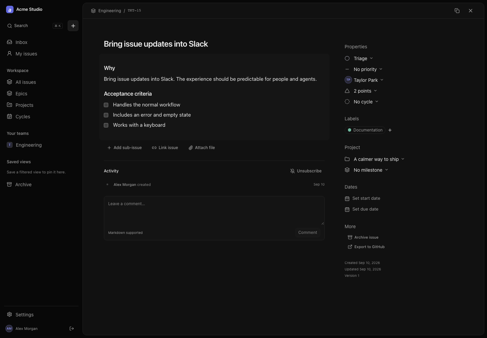
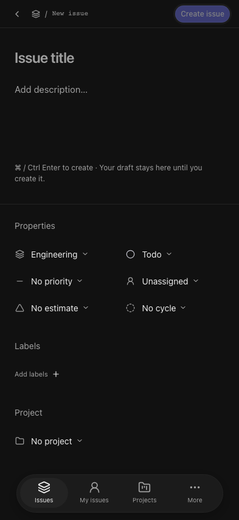
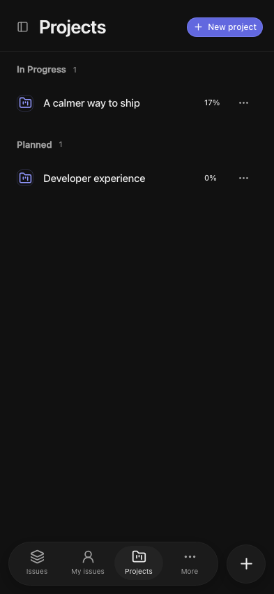
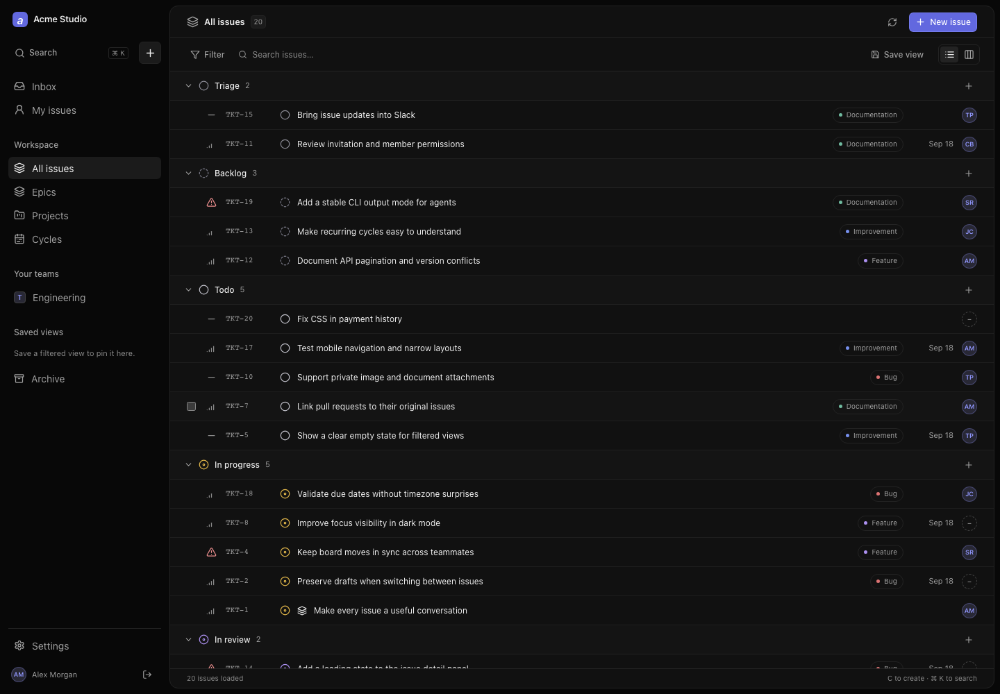
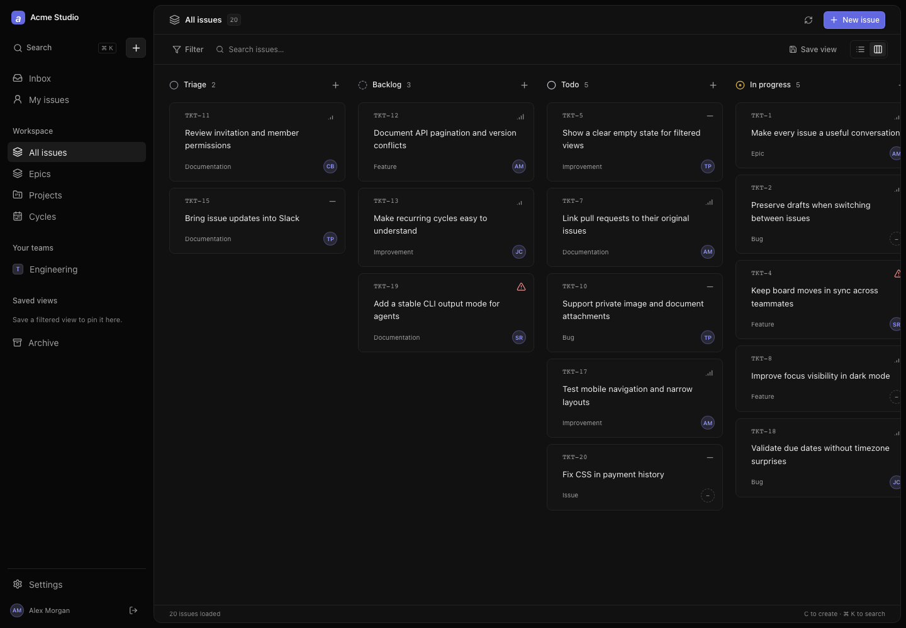
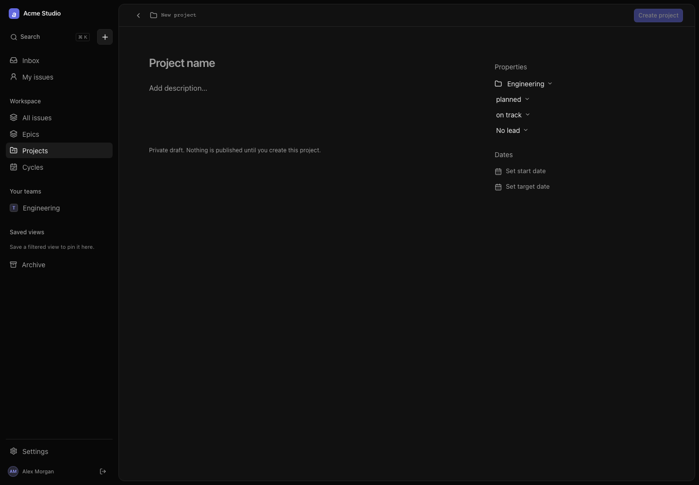
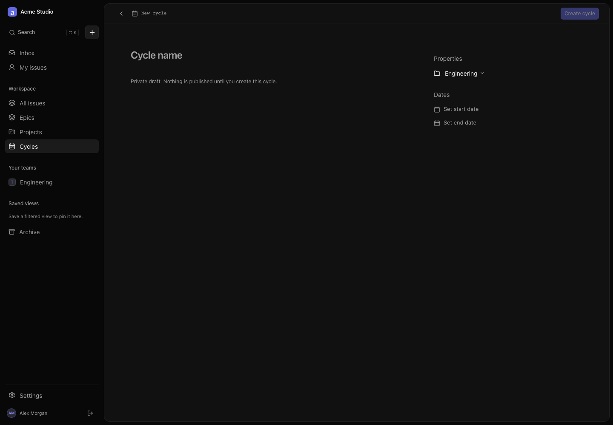
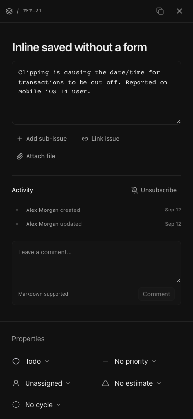
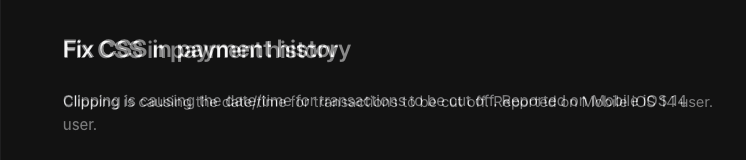

# tickets-app

Modular, keyboard-first issue tracking for a small team. React + Base UI, Bun, Oxc, PostgreSQL, private attachments, a CLI and a schema-checked subset of Linear GraphQL.

**[Latest UI review](docs/REVIEW-FOLLOWUP.md)** · **[Open Tickets](https://tickets-ultrabricks.vercel.app)** · **[Release verification](docs/RELEASE-2026-09-12.md)** · **[Source: Forgejo](https://git.hyperide.ai/ultrabricks/tickets-app)** · **[Operations](docs/OPERATIONS.md)** · **[Design](DESIGN.md)** · **[GraphQL schema](packages/linear/schema.graphql)**

**Release status (12 September 2026):** deployed to the existing Vercel project, with production PostgreSQL schema/owner readiness confirmed and anonymous workspace access denied. Local browser and PostgreSQL acceptance pass. Authenticated production browser and live private-Blob acceptance are still explicitly pending; see the [current release report](docs/RELEASE-2026-09-12.md). Public application access never makes workspace data public.

## The interface

New issues, projects and cycles open directly as document pages. Title, Markdown body and compact properties edit in place. Existing documents save committed edits without a global Save form. New drafts publish only on Create; uncertain creation responses reuse the identical idempotency key and payload.



 

<details><summary>Lists, board, planning and mobile</summary>







</details>

These are browser captures of the real React app on synthetic local data. [Current capture settings](docs/screenshots/release/capture.json). [Provenance](docs/screenshots/parity/provenance.json) records viewport, DPR, source revision and hashes.

### Comparison with Linear

The public Linear issue demo is captured at the same 1440×1000 viewport and DPR 1. The audit produces a **50% pixel overlay**, an absolute difference image (4× gain) and DOM measurements, without scaling, warping or shifting screenshots.



[Full overlay](docs/screenshots/parity/issue-detail-overlay.png) · [Difference image](docs/screenshots/parity/document-diff-x4.png)

This is not a claim of 100% parity: font rendering, navigation modules, data, avatars and activity differ. Page-first creation intentionally follows this project's requirement rather than the public demo's modal. The current release implements long press, press–slide–release, peek and mobile navigation, but no screenshot implies complete native-iOS or 50-screen parity.

## Run locally

```sh
git clone https://git.hyperide.ai/ultrabricks/tickets-app.git
cd tickets-app
bun install --frozen-lockfile
bun run setup -- --demo --port 8888
bun run dev
```

Open `http://localhost:5173`. API port **8888** is the single shared default; setup persists explicit overrides in ignored `.env.local`. The launcher and Vite share configuration and fail clearly on collisions or an unavailable backend. Localhost aliases work only in development; production checks exact HTTPS Origin.

Explicit local demo credentials: `demo@example.test` / `local-demo-password`. Repeating setup keeps existing accounts, passwords and data. Do not delete the database to upgrade and never run `--demo` against production. A non-demo owner is initialized explicitly as described in [operations](docs/OPERATIONS.md).

## Modules

| Module | Implemented behavior |
| --- | --- |
| Identity | Workspaces, teams, owner/admin/member/viewer roles, password sessions, scoped expiring tokens, invitations and exact-domain invitation policy. |
| Tickets | Identifiers, statuses, labels, assignees, priorities, Markdown, dates, estimates, comments, activity, epics/subissues, blocking/related/duplicate links, archive and soft deletion. |
| Planning | Projects, leads, health/status, dates, milestones, team cycles and versioned edits. Projects/cycles use shared inline document pages. |
| Views | Search, URL filters, list/board modes, ordering, bulk updates and saved views. |
| Notifications | Subscriptions and in-app notifications. |
| Attachments | Authenticated private local, S3/R2 or Vercel Blob storage; size/MIME checks and workspace limits. |
| Provider integrations | Signed GitHub/Slack events, deduplication and durable inbox/outbox. Own provider credentials/installations are required for live delivery. |

Optional modules are gated by the server, not only navigation. This is a modular monolith, not an untrusted plugin runtime. GraphQL and REST share domain services, workspace boundaries, audit history and transactional validation.

In **Settings → Security**, owners/admins can edit `allowed_email_domains`. It is checked both when sending and accepting invites, including older tokens. Domains match exactly, normalize IDNA/case and do not automatically include subdomains. Existing users are not unexpectedly locked out by changing invitation policy.

## Drafts, conflicts and keyboard

Tab-private drafts survive navigation and reload. A delayed save cannot erase newer typing. Remote conflicts retain local text and show explicit server/local choices. Rich Markdown uses Tiptap; unsupported extended constructs remain editable as source rather than being silently dropped. Raw HTML is not executed and external images are not automatically fetched.

Hold the ellipsis affordance or a card’s non-text area to preview it; slide to an action and release to activate. Moving before the hold threshold, canceling a touch pointer, scrolling, or Escape cancels appropriately. Text retains native selection. Desktop also supports ellipsis hover, right-click on non-text space and Space for quick preview. Mobile navigation is a safe-area-aware floating dock with a contextual create button.

`J/K` or arrows move through visible issues; Enter opens; `X` selects; `C/V` opens the new issue page; `G` then `I/M/P/C` navigates; `?` opens help. Cmd/Ctrl+K deliberately works inside editors. Ordinary shortcuts do not hijack typing, IME, selection or active popovers. Escape cancels the active edit or returns from issue details.

No full realtime collaboration, offline synchronization or account/password-recovery system is implied.

## API and CLI

`POST /graphql` and `/api/graphql` implement the supported Linear schema subset. The [allowlist](packages/linear/contract.mjs) and pinned upstream schema drive generation; CI checks names, arguments, input/output types and nullability. Unsupported selections fail explicitly. This does not imply every generated query in the full official Linear SDK is supported.

```graphql
query WorkQueue {
  issues(first: 20, filter: { priority: { lte: 2 } }) {
    nodes { id identifier title state { name type } }
    pageInfo { hasNextPage endCursor }
  }
}
```

Use a token issued by this installation, not by Linear. Raw or Bearer authorization is accepted for GraphQL; browser writes additionally require same-origin CSRF protection. Pagination cursors are signed and scoped; depth/complexity limits and parameterized filters protect the service.

The internal REST contract is [docs/openapi.json](docs/openapi.json). It exposes installation-specific features such as modules, conflict versions and workspace policy.

```sh
bun packages/cli/tickets.mjs --help
bun packages/cli/tickets.mjs auth login --url https://your-installation.example < token.txt
bun packages/cli/tickets.mjs issues list --all --json
bun packages/cli/tickets.mjs issues get TKT-1 --json
bun packages/cli/tickets.mjs issues update TKT-1 --version 1 --priority 2
```

Alternatively use `TICKETS_URL` and `TICKETS_TOKEN`. Credentials are not passed in command-line arguments. SDK/CLI writes are not blindly retried.

## Architecture and tokens

FSD layers: `src/app → pages → widgets → features → entities → shared`. TanStack Query owns server state, Zustand owns preferences, and routing/filter state belongs in the URL. Shared document and property primitives serve new and existing objects.

[DESIGN.md](DESIGN.md) provides design context. [DTCG JSON](tokens/tickets.tokens.json) is executable: `bun run tokens:build` generates CSS, TypeScript and reference documentation. Alias/type/cycle checks fail on unsupported values; `tokens:check` detects drift. No font binaries are distributed.

Bun drives scripts/server/tests/CLI; Oxc provides lint/type-aware checks/formatting, with independent `tsc --noEmit` verification.

## Verification

```sh
bun run check
bun run typecheck:tsc
bun run check:secrets
bun run storybook:build
bun run test:ui
bun run test:e2e
bun --bun playwright test --project=webkit
bun run test:visual
```

PostgreSQL acceptance requires an explicit isolated `TEST_DATABASE_URL`; it never falls back to SQLite. Visual baseline generation is an explicit review action, not a passing regression comparison. To audit Linear from an isolated local test server:

```sh
TEST_BASE_URL=http://localhost:5173 bun scripts/reference-audit.mjs
```

The scanner rejects private runtime files even if force-added to Git. Keep `.env*`, credentials, databases, browser sessions and build output out of commits. A secret scan is not a security audit.

## Deployment and remaining acceptance

Use the existing Vercel project and native CLI authorization, not the retired GitHub publication workflow. The [operations runbook](docs/OPERATIONS.md) separates deployment, migrations, first owner, private Blob/S3 and live provider installations. A private Blob store needs `STORAGE_DRIVER=blob` and `BLOB_READ_WRITE_TOKEN`; S3/R2 uses its own server-only variables. Defaults are 3 MiB per file and 500 MiB per workspace. No antivirus, full media pipeline or physical-object garbage collector is claimed.

The production schema/owner readiness is confirmed. Authenticated live acceptance and actual GitHub/Slack installations remain separately recorded checks. Missing provider credentials are not inherited from the assistant. `bun run worker` processes one inbox/outbox batch; hosting must schedule it for continuous integration delivery.

## License

Independent implementation, not a Linear product. Original code is MIT; the pinned upstream schema retains its license under `vendor/linear`. Public reference screenshots are used for comparison, not as application assets. Contributions follow [AGENTS.md](AGENTS.md).
