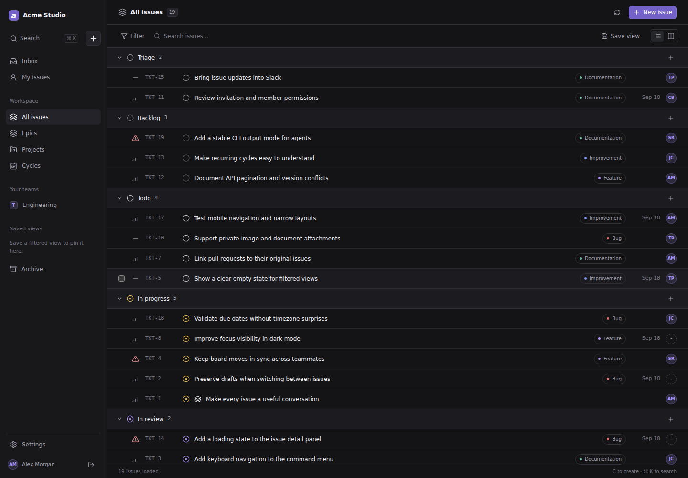
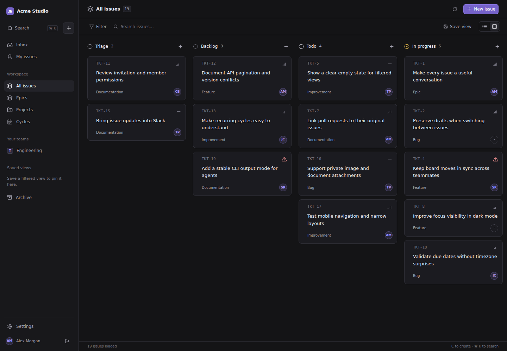
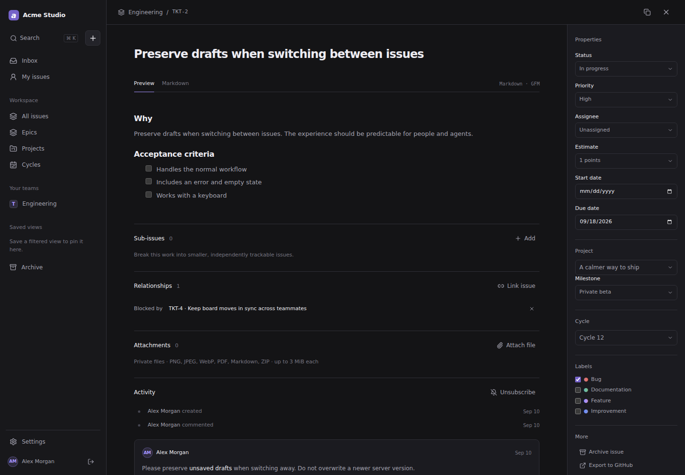
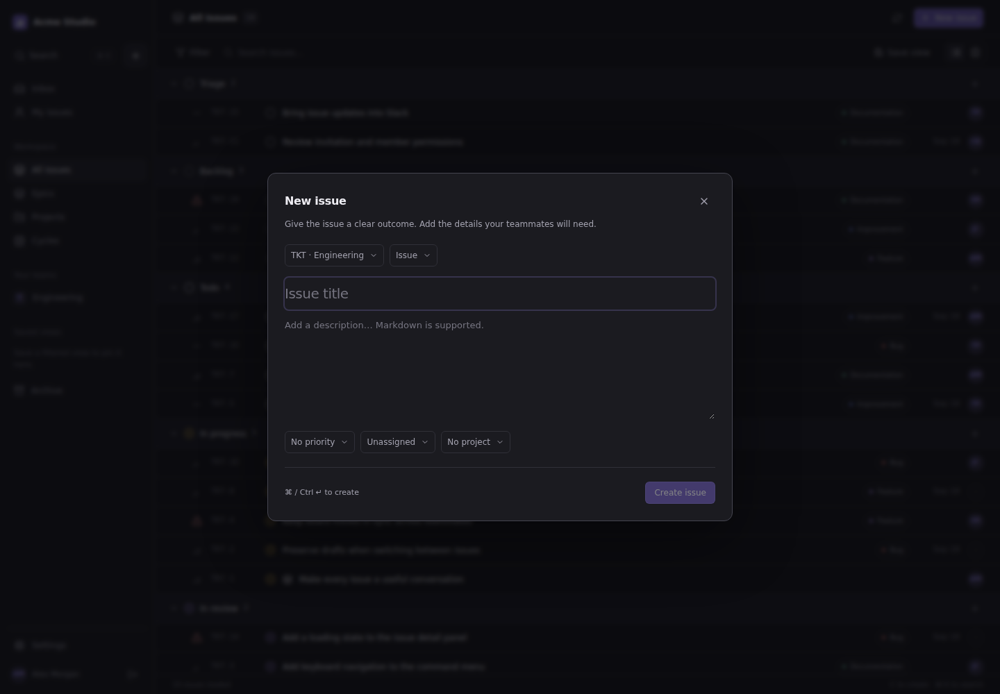
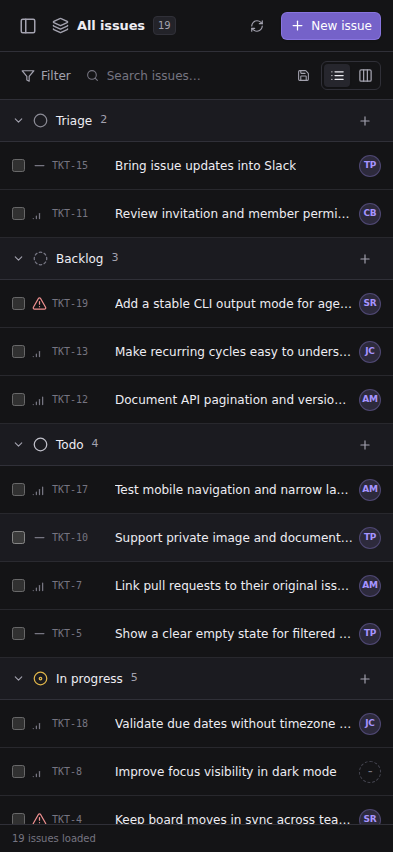
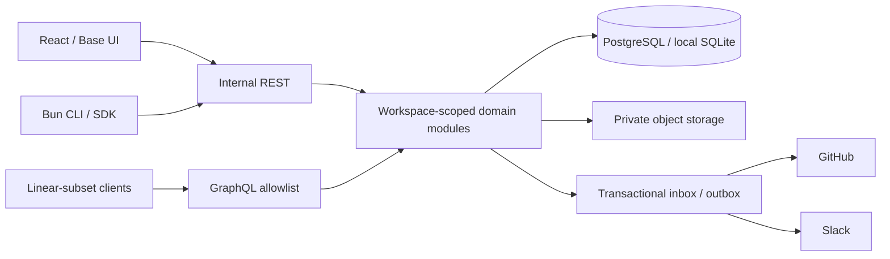

# tickets-app

[](https://github.com/alex-mextner/tickets-app/actions/workflows/ci.yml)

A modular, API-first issue tracker for a small team. React, owned Base UI components, executable DTCG tokens, PostgreSQL, a Bun CLI, and a **schema-checked subset of Linear's GraphQL API**.

**Status:** application source, tests, generated contracts and real browser screenshots are committed. This is a working development release, not feature-complete Linear parity. A public production deployment and live third-party installations are **not yet verified**. Public source code does not make workspace data public.

## Screenshots

These are captures of the running React application against a synthetic local workspace, not static HTML mockups. The exact source commit, CI run and image hashes are recorded in [screenshot provenance](docs/screenshots/provenance.json). Normal visual CI compares reviewed baselines; it does not silently replace them.

### Issue list



### Board



<details>
<summary>Issue details, creation and narrow-screen layout</summary>







</details>

## Run locally

Use **Bun 1.4.2 or later**; `.bun-version` and `bun.lock` pin the tested toolchain. Node is not required for the application server, CLI or project scripts.

```bash
git clone https://github.com/alex-mextner/tickets-app.git
cd tickets-app
bun install --frozen-lockfile
bun run setup -- --demo
bun run dev
```

Open **<http://localhost:5173>**. The API listens on port 8888 and Vite proxies requests to it. Local demo login: `demo@example.test` / `local-demo-password`. These credentials are only for the explicit, synthetic SQLite demo. Demo seeding refuses production or a configured cloud database.

Setup generates private random secrets in an ignored `.env.local` and preserves an existing file. The demo bootstrap is intended for a fresh database, not for repeatedly reseeding a workspace. `bun run setup` without `--demo` prepares the environment for your own owner account; use the private `BOOTSTRAP_*` variables and the explicit migration/bootstrap commands instead.

```bash
bun run db:migrate
bun run db:bootstrap
bun run storybook
```

Storybook runs on port 6006. Never expose the development server or demo credentials as a production service.

## Implemented modules

| Module | Current implementation |
| --- | --- |
| Identity, required | Workspaces, teams, memberships, owner/admin/member/viewer roles, password login, invitations, expiring sessions and scoped personal API tokens. |
| Tickets, required | Team identifiers, configurable statuses, priorities, labels, assignee/creator, Markdown, comments, start/due dates, estimates, ordering, epics/subissues, blocking/related/duplicate relations, activity, archive/restore and soft deletion. |
| Planning | Projects with lead, dates, status/health, project teams and milestones. Milestone CRUD is available through the API; not every planning capability has a complete dedicated screen. |
| Cycles | Team-scoped time intervals and assignment of issues. No automatic rollover yet. |
| Views | URL filters, search, list/board mode and saved views. |
| Notifications | Issue subscriptions, activity and in-app notifications. |
| Attachments | Private local or S3-compatible storage, size/type checks, authorization and expiring download URLs. |
| GitHub | Signed webhooks, repository/workspace checks, deduplication, issue import/export and PR links/status transitions. |
| Slack | Signed slash commands/shortcuts, mapped members and outgoing notifications. |

Optional modules are gated on the server, not just hidden in navigation. Disabling a module retains its data. This is a **modular monolith**, not a runtime for arbitrary untrusted plugins.

Core writes use shared domain services regardless of transport. Optimistic concurrency rejects stale REST writes instead of overwriting another person's work. Bulk edits are transactional; creation supports idempotency keys; hierarchy and blocking cycles are rejected; related objects must belong to the same workspace and appropriate team/project.

## API: Linear-compatible subset, not renamed REST

**`POST /graphql`** (also `/api/graphql`) uses the official Linear schema pinned under [vendor/linear](vendor/linear). The generated supported schema is [packages/linear/schema.graphql](packages/linear/schema.graphql); [contract.mjs](packages/linear/contract.mjs) is the explicit allowlist. Generation preserves supported field names, argument/input types, nullability, enums and connection shapes. CI verifies the subset against the upstream snapshot.

Supported roots cover issues, users, teams, workflow states, labels, projects, milestones, comments, relations and priority values. Mutations cover issue creation/update/archive/restore/soft deletion/labels, comment creation, relation creation/deletion, project creation/update and milestone creation. Cycles currently use the internal REST API, not GraphQL.

```graphql
query WorkQueue {
  issues(first: 20, filter: { priority: { lte: 2 } }) {
    nodes {
      id
      identifier
      title
      priorityLabel
      state { name type }
      assignee { id name }
    }
    pageInfo { hasNextPage endCursor }
  }
}
```

Use a personal token issued by **this installation** in `Authorization: <token>` or `Authorization: Bearer <token>`. A token issued by Linear itself is not valid here. Cookie-authenticated writes also require the same-origin CSRF header `x-tickets-csrf: 1`.

Supported queries include parameterized filters, forward/backward keyset pagination and authenticated scope-bound cursors. Requests have depth/complexity/size budgets. Unsupported operations, selections or inputs fail explicitly. **This does not mean the entire official Linear SDK works:** its generated selections may request fields outside this subset. Schema compatibility and the tested scenarios are not a claim of behavioral identity for every Linear edge case.

The internal **REST `/api/v1`** exposes tickets-app-specific features such as module settings and conflict versions. Its generated contract is [docs/openapi.json](docs/openapi.json). Both APIs share authorization, workspace boundaries, audit history and transactional services.

## CLI

```bash
bun packages/cli/tickets.mjs --help
bun packages/cli/tickets.mjs auth login --url https://your-installation.example < token.txt
bun packages/cli/tickets.mjs issues list --all --json
bun packages/cli/tickets.mjs issues get TKT-1 --json
bun packages/cli/tickets.mjs issues update TKT-1 --version 1 --priority 2
bun packages/cli/tickets.mjs issues create --team TKT --title "Document the release" --body-file issue.md
```

Alternatively provide `TICKETS_URL` and `TICKETS_TOKEN` through your environment. Login reads the token from stdin, not a command-line argument. JSON output is suitable for agents; exit codes distinguish usage, authentication and conflicts. Mutations are not blindly retried. The CLI and [SDK](packages/sdk/index.mjs) use the same API as the browser.

## Architecture and design



Frontend FSD layers are `src/app → pages → widgets → features → entities → shared`; imports are checked by `bun run lint:fsd`. TanStack Query owns server state, Zustand owns small UI preferences, and navigation/filters belong in the URL. Unsaved descriptions retain their original version and do not get overwritten by refreshes. The server lives under `packages/server/modules` with shared contracts, database adapters and transport wrappers.

Read [DESIGN.md](DESIGN.md) before changing UI. [tokens/tickets.tokens.json](tokens/tickets.tokens.json) is the executable DTCG source, not a reference-only file. The generator emits CSS, TypeScript and [token documentation](docs/tokens.md), validates aliases/types and rejects cycles. It supports the token types used here, not every possible DTCG extension.

```bash
bun run tokens:build
bun run tokens:check
bun run graphql:generate
bun run graphql:check
```

Oxc provides Oxlint, type-aware checking, Oxfmt and Vite/Rolldown transforms. A separate `tsc --noEmit` check prevents successful transpilation being mistaken for type correctness.

## Verification

[CI](https://github.com/alex-mextner/tickets-app/actions/workflows/ci.yml) runs independent quality, PostgreSQL and browser jobs. Inspect the exact commit's result rather than assuming the badge covers unpushed local changes.

```bash
bun run check                 # generated contracts, FSD, Oxc, unit/integration, production build
bun run typecheck:tsc
bun run check:secrets
bun run storybook:build
bun x --no-install playwright install --with-deps chromium
bun run test:ui               # real browser stories + axe accessibility
bun run test:e2e
bun run test:visual           # compare committed, reviewed baselines
```

`bun run test:postgres` requires an explicit `TEST_DATABASE_URL` for a disposable PostgreSQL database with permission to create isolated test schemas. It reuses the domain/HTTP/GraphQL acceptance suites and does not fall back to SQLite. Production databases are not test targets.

Visual changes require `bun run screenshots`, inspection of the actual images and an explicit baseline commit. Initial capture is not a passed regression comparison. Browser artifacts include the tested commit. Unit tests exercise concurrency/conflicts, tenant boundaries, permissions, invitation security, signed webhooks, outbox behavior, CLI HTTP requests and GraphQL contracts; they are not a substitute for a security audit or live provider acceptance.

## Deployment and integration boundaries

[vercel.json](vercel.json) configures a Bun function, Frankfurt region, the Vite build and SPA/API routing. PostgreSQL migrations are explicit, never performed as a side effect of an HTTP request or frontend build. The cloud adapter fails closed without `DATABASE_URL`; it never serves a production SQLite/demo fallback.

At minimum configure `DATABASE_URL`, a private random `AUTH_SECRET` of at least 32 characters, `APP_URL` matching the actual HTTPS origin, and `NODE_ENV=production`. Migrations use `DATABASE_URL_UNPOOLED`. Keep bootstrap passwords outside the deployed runtime. Private uploads require `STORAGE_DRIVER=s3` and the S3 variables in [.env.example](.env.example).

Cloudflare R2 is supported through the S3 adapter; a bucket is not automatically provisioned. Application defaults are **3 MiB per upload / 500 MiB per workspace**, independent of provider free quotas. Upload content is inspected, but there is no antivirus scan or full media transcoder.

GitHub/Slack code is present and tested with signed synthetic events and injected transports. You must install/configure their own apps or webhooks and supply credentials for an explicitly configured workspace. Assistant connector access is not inherited by the deployed app. There is no complete OAuth installation UI or universal two-way field synchronization yet.

Integrations use a durable inbox/outbox with retries and at-least-once delivery. `bun run worker` processes one batch and must be scheduled by your host. The authenticated `POST /api/internal/jobs` endpoint is another option. External delivery is not guaranteed simply because an event was enqueued.

## Remaining work

Verified production deployment, private bucket provisioning, live GitHub/Slack acceptance and backup/restore drills remain release requirements. Product expansion includes OAuth/password recovery/MFA, full milestone/project editing screens, issue templates and richer triage, broader GraphQL coverage, realtime/offline synchronization, and more browser engines/keyboard/drag-and-drop scenarios. No initiative portfolio, timeline forecasting or full Linear parity is implied.

## Contributing and attribution

Use atomic commits, retain tests for corrected failures, and follow [AGENTS.md](AGENTS.md). Do not commit environment files, tokens, databases, authenticated browser state, source archives or font binaries. This is an independent implementation, not a Linear product. The upstream Linear schema retains its MIT license and provenance in `vendor/linear`.
